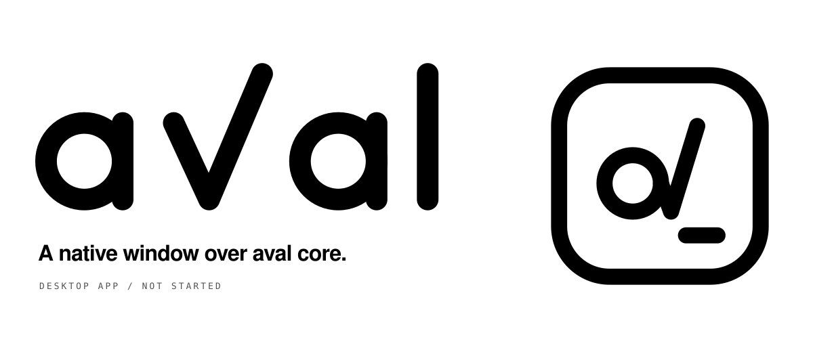

<picture>
  <source media="(prefers-color-scheme: dark)" srcset="docs/assets/hero-dark.3404bd94.svg">
  
</picture>

 
 

 

[**Status**](#status) &nbsp;·&nbsp;
[**How it relates to aval**](#how-it-relates-to-aval) &nbsp;·&nbsp;
[**Next steps**](#next-steps) &nbsp;·&nbsp;
[**Contributing**](#contributing) &nbsp;·&nbsp;
[**aval →**](https://github.com/alvaroofernaandez/aval)

 

## What aval desktop is

<picture>
  <source media="(prefers-color-scheme: dark)" srcset="docs/assets/mark-dark.872815f5.svg">
  
</picture>

aval desktop is a native window over [`aval core`](https://github.com/alvaroofernaandez/aval)
with an embedded terminal: one lightweight app that is shell, multiplexer and
agent workspace at once. It is the last stage of the aval roadmap, the piece
that replaces the terminal emulator. Its mark is the aval mark inside an app
frame, followed by a terminal cursor.

 

## Status

**Not started.** This repository holds no code yet, and nothing here is
installable. The GUI toolchain is undecided; choosing it is the first task
([issue #1](https://github.com/alvaroofernaandez/aval-desktop/issues/1)), and
no code is written before that decision is recorded as an ADR.

 

## How it relates to aval

aval desktop is a client of `aval core`. It starts the `aval` binary and talks
to it over a versioned JSON-RPC protocol on stdio; it never imports aval's Go
code.

| Question | Answer |
| :--- | :--- |
| Where does the decision live? | aval ADR 0008, [a process boundary between core, memory and desktop](https://github.com/alvaroofernaandez/aval/blob/main/docs/adr/0008-process-boundary-core-memory-desktop.md), accepted on 2026-11-24. |
| Who owns the protocol? | aval. The specification and its conformance suite live in the aval repository. |
| What if desktop needs a new call? | Two pull requests, one per repository, linked by protocol version. Never a shared commit. |
| When does it ship? | Roadmap milestone [v0.9.0](https://github.com/alvaroofernaandez/aval/milestone/5), after aval core (v0.6.0) and the aval TUI (v0.7.0). |

 

## Next steps

1. **Spike: choose the GUI toolchain** ([issue #1](https://github.com/alvaroofernaandez/aval-desktop/issues/1)),
   recorded as `docs/adr/0001-*.md`.
2. Wait for the protocol from aval core (milestone
   [v0.6.0](https://github.com/alvaroofernaandez/aval/milestone/3)): this
   repository follows it, it does not lead it.
3. A first window that starts `aval` and renders one embedded terminal.

 

## Contributing

Open an issue first; work starts once it is labelled `status:approved`. Read
[CONTRIBUTING.md](CONTRIBUTING.md) and the [Code of Conduct](CODE_OF_CONDUCT.md).
Vulnerabilities go through [SECURITY.md](SECURITY.md), never a public issue.

## License

[MIT](LICENSE)
